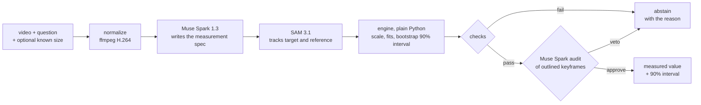

# Caliper

**AI guesses. Caliper measures.**

Ask how big, how fast, or how hard something accelerates in a video. Caliper returns a measured number with a 90% interval, or says it can't measure it and why. Point it at a street and it runs a speed survey: every vehicle it can measure, with an error range, and the 85th-percentile speed engineers use for road-safety decisions.

Built during the Meta Global AI Developer Hackathon (building period Oct 27 to Nov 4 2026), Indie track.

**Live demo:** _URL added after deploy (docs/DEPLOY.md)._ The recorded example runs work without the backend; live runs are on for judging, inside hard spend caps.

## Why

Vision-language models guess physical quantities. On Stanford's [QuantiPhy](https://quantiphy.stanford.edu/) benchmark the best model on the public leaderboard scores below the human baseline, and the authors found models answer plausibly even with no video ([Stanford HAI](https://hai.stanford.edu/news/ai-cant-do-physics-well-and-thats-a-roadblock-to-autonomy)).

**Who it helps.** Anyone who needs a number from a phone video and must know when not to trust it. The showcase is residents and road engineers who want evidence that a street is too fast: the 85th-percentile speed is the figure traffic-calming decisions rest on, and a speed gun or a traffic survey is out of reach for most residents. This is road-safety evidence, not enforcement.

On roads the cost is concrete: India recorded 177,175 road deaths in 2024, and the transport ministry attributes 70.3% to over-speeding ([Hindustan Times on the MoRTH 2024 report](https://www.hindustantimes.com/india-news/road-accident-deaths-increased-2-5-in-2024-from-2023-morth-report-101781204793385.html)).

## How it works

1. **Muse Spark 1.3** reads the question and the video and writes a measurement spec: what to track, what sets the scale, which quantity.
2. **SAM 3.1** tracks the target and the scale reference through the clip.
3. **Plain Python** converts pixels to metres, fits motion over time, and bootstraps a 90% interval.
4. **Checks** refuse to answer when the target is lost, nothing has a known size, or two estimates disagree.
5. **Muse Spark audits the evidence**: it looks at the tracked keyframes (never the numbers) and vetoes the result if SAM followed the wrong object or the scale reference sits in the wrong plane.



The language model never produces the final number: every number comes from `backend/caliper/engine.py` or `study.py`, and the audit can only veto.

## Results

<!-- results:start (generated by make report; do not edit by hand) -->

**Caliper answers about 1 question in 5. When it answers, on unseen videos (QuantiPhy holdout) 60% of its answers are within 10%, against 27% for Muse Spark alone on the same questions; 7% are off by more than 2x, against 20%; and its 90% range held on 13 of 15.**

**Claim H1 failed.** We pre-registered that Caliper would beat Muse Spark alone by at least 10 points of official MRA on the holdout split. It did not: 20.1 against 58.1. The official score counts every refusal as a miss, and Caliper answers 15 of 69 holdout questions.

**The audit is a cautious check: both its vetoes were false alarms.** On holdout it vetoed one that was correct (1.5% error); on dev it vetoed one whose truth was inside its 90% range (22.2% error). Neither answer it vetoed was wrong, so these were false alarms: each cost an answer, and a veto can never change a number. It ships as is, as frozen before the holdout run.

### QuantiPhy validation, official evaluator

MRA on QuantiPhy's 0 to 100 scale. Official MRA counts a refusal as a miss; answered-only columns score just the questions a variant answered.

| Split | Variant | n | Official MRA | Answered | Answered-only MRA | Within 10% (answered) | Off by >2x (answered) |
| --- | --- | --- | --- | --- | --- | --- | --- |
| holdout (never used for tuning) | Muse Spark alone | 69 | 58.1 | 97% | 59.6 | 28% | 24% |
| holdout (never used for tuning) | Caliper (with audit, as shipped) | 69 | 20.1 | 22% | 82.0 | 60% | 7% |
| holdout (never used for tuning) | Caliper, audit off | 69 | 22.9 | 23% | 83.1 | 62% | 6% |
| dev (used for tuning) | Muse Spark alone | 89 | 62.0 | 100% | 62.7 | 31% | 16% |
| dev (used for tuning) | Caliper (with audit, as shipped) | 89 | 10.6 | 11% | 92.0 | 70% | 0% |
| dev (used for tuning) | Caliper, audit off | 89 | 11.1 | 12% | 90.0 | 64% | 0% |
| full (dev + holdout) | Muse Spark alone | 158 | 60.5 | 99% | 61.4 | 30% | 19% |
| full (dev + holdout) | Caliper (with audit, as shipped) | 158 | 15.0 | 16% | 86.0 | 64% | 4% |
| full (dev + holdout) | Caliper, audit off | 158 | 16.1 | 17% | 85.9 | 63% | 4% |

### Like for like: Muse Spark alone on exactly the questions Caliper answered

| Split | Variant | Answered | MRA Caliper / Muse | Within 10% Caliper / Muse | Off by >2x Caliper / Muse | 90% range held |
| --- | --- | --- | --- | --- | --- | --- |
| holdout (never used for tuning) | Caliper (with audit, as shipped) | 15 | 82.0 / 66.0 | 60% / 27% | 7% / 20% | 13 of 15 |
| holdout (never used for tuning) | Caliper, audit off | 16 | 83.1 / 66.9 | 62% / 25% | 6% / 19% | 14 of 16 |
| dev (used for tuning) | Caliper (with audit, as shipped) | 10 | 92.0 / 68.0 | 70% / 30% | 0% / 0% | 10 of 10 |
| dev (used for tuning) | Caliper, audit off | 11 | 90.0 / 67.3 | 64% / 27% | 0% / 0% | 11 of 11 |
| full (dev + holdout) | Caliper (with audit, as shipped) | 25 | 86.0 / 66.8 | 64% / 28% | 4% / 12% | 23 of 25 |
| full (dev + holdout) | Caliper, audit off | 27 | 85.9 / 67.0 | 63% / 26% | 4% / 11% | 25 of 27 |

### Our own clips (field set, never used for tuning)

| Set | What | Clips | Measured | Median error | 90% range held | Muse Spark alone median error |
| --- | --- | --- | --- | --- | --- | --- |
| Set A | car speed vs GPS | 10 | 0 | n/a | n/a | 41% |
| Set B | drop, g vs 9.81 | 10 | 0 | n/a | n/a | <1% |
| Set C | size vs tape | 10 | 10 | 11% | 90% | 14% |
| Set D | no reference: should refuse | 4 | 0 | n/a | n/a | n/a |

Sources: eval/results.csv, eval/paired_results.csv, eval/field_results.csv, eval/field_guesses.csv, eval/interval_calibration.csv, eval/quantiphy_answers.csv. Generated 2026-11-03T07:42:40+00:00.

<!-- results:end -->

## Street speed study

Same engine, different question: film a street with two marks a measured distance apart, draw a gate line through each mark, and Caliper times every vehicle between the gates, gives each one a 90% range or says why it has no reading, and reports the median and the 85th-percentile speed with its own range (`backend/caliper/study.py`; also an MCP tool below).

<!-- TODO(clips 2026-11-03): bike Set A (gate method vs GPS, claim H5) and S02 (the street study) results go here, generated by make report from eval/h5_results.csv and the cached S02 study run. Do not type numbers here. -->
> **Pending clips.** The first Set A could not test the gate method (its markers stood on the far kerb, not in the car's lane; docs/DECISIONS.md 2026-11-02), and the first street clip had no lane with both marks in view. The refilmed bike Set A and the S02 street clip arrive on Nov 3; their results will be generated here. Until then claim H5 is open.

## Prior art

Measuring motion from video is not new. What each of these says it does, in its own README or site (read 2026-11-03):

- **[Tracker](https://github.com/OpenSourcePhysics/tracker)** (Open Source Physics, GPL-3.0): "Video analysis and modeling tool built on the Open Source Physics (OSP) framework."
- **[MotionLab](https://github.com/KuzeyGorgulu/motionlab)**: "a local-first browser tool for turning ordinary videos into measurable physics experiments", with "planar spatial calibration with scale, origin, axis direction, and physical units" and CSV/JSON export; its README notes that a single planar calibration "does not remove perspective, parallax, lens distortion, or depth error."
- **[VeloCV](https://github.com/aviamin/velocv)**: "Track any object in a video and measure its real-world speed and acceleration — from a single camera, no special equipment", from a box drawn on one frame; scale comes from gravity's curvature for free flight or from the object's known size with checkerboard camera calibration, and large fit residuals trigger "an explicit notice, not a silently wrong number."
- **[Motion Lab](https://github.com/michaellomuscio/motion-lab)**: "Turn a phone video of anything moving into real physics data", with a ruler in the plane of the motion for scale, and graphs, an annotated video and a report with fitted accelerations and R².
- **[Speedcam Anywhere](https://www.speedcamanywhere.com/)**: "an AI system that can accurately and verifiably measure vehicle speeds using a mobile phone camera", from the vehicle's wheelbase; it states about +/-10% in Basic mode and better than +/-2 mph in Pro mode, and that it "has not been approved in the UK" as a speed camera.

What Caliper adds:

- **It plans the measurement from a plain question.** "How fast is the white car in m/s?" becomes a measurement spec (target, scale reference, quantity, time) written by Muse Spark; nobody draws a box or a calibration line, and the model never writes the number.
- **It refuses when the video cannot support a number,** and says why (checks plus a visual audit that can only veto).
- **Every answer has a 90% range, checked on unseen videos:** coverage on the QuantiPhy holdout split is in the results block above.
- **It is scored on a public benchmark** (Stanford's QuantiPhy, official evaluator, dev/holdout split fixed before tuning), including the result that went against us.

## Run it

See [docs/SETUP.md](docs/SETUP.md). Short version:

```
cp .env.example .env    # add MODEL_API_KEY
make setup
make dev-api            # http://localhost:8000
make dev-web            # http://localhost:3000
```

Recorded runs from our own field clips live in `web/public/runs/` and work without the backend (plates and faces blurred). Live runs need `LIVE_RUNS_ENABLED=true` and stay inside the caps in `.env`. Hosting: docs/DEPLOY.md.

### Reproduce the numbers

```
make report     # $0: rebuilds web/public/results.json and the results block in this README from the eval CSVs
make eval       # costs money on a clean cache (the from-scratch cost is the cost_usd column of
                # eval/results.csv): every QuantiPhy question, frozen code only, each step capped
```

The QuantiPhy validation data is downloaded separately (docs/SETUP.md); its videos are never committed or shown. Thresholds were tuned on the dev split only and frozen before the holdout run (docs/EVAL_PROTOCOL.md, docs/DECISIONS.md "Freeze").

## Use Caliper from another agent (MCP)

`backend/caliper/mcp_server.py` exposes two tools over MCP (stdio): `measure(video_path, question, prior=None)` returns the same `Result` the app shows (a value with its 90% interval, or an abstention with the reason), and `study(video_path, gates, distance_m)` returns a `StudySummary` (per-vehicle speeds with intervals, median, 85th percentile). Both go through the live-run caps in `.env`, so `LIVE_RUNS_ENABLED=true` is needed, and cached calls cost nothing.

```
pip install -e "backend[mcp]"
python -m caliper.mcp_server          # stdio server; run from backend/ or with backend on PYTHONPATH
```

Another agent calling it (the official `mcp` Python SDK, 2.x):

```python
import asyncio
from mcp import ClientSession, StdioServerParameters
from mcp.client.stdio import stdio_client

server = StdioServerParameters(command="python", args=["-m", "caliper.mcp_server"])

async def main() -> None:
    async with stdio_client(server) as (read, write), ClientSession(read, write) as session:
        await session.initialize()
        out = await session.call_tool("measure", {
            "video_path": "clips/phone_on_desk.mp4",
            "question": "What is the length of the phone in cm?",
            "prior": "The INR 10 coin is 0.027 m in diameter.",
        })
        r = out.structured_content
        print(r["status"], r["value"], r["unit"], r["interval_90"], r["abstain_reason"])

asyncio.run(main())
```

Gates for `study` are two lines in pixels on frame 0 of the normalized video: `{"gate_a": {"a": [x, y], "b": [x, y]}, "gate_b": {...}}`. For Claude Code, add it to `.mcp.json` as `{"caliper": {"command": "python", "args": ["-m", "caliper.mcp_server"]}}`.

## Limitations

Every figure behind these points is in the generated results block above.

- **It refuses most questions.** The official QuantiPhy score counts a refusal as a miss, so Caliper scores far below the model alone and claim H1 failed. Its value is in the answers it does give and in saying why it will not answer the rest.
- **Depth is the weak spot.** Moving objects in 3D scenes (QuantiPhy category D3) are refused on every holdout question, and static 3D (S3) is the least accurate category Caliper does answer (per-category rows in `eval/paired_results.csv`).
- **The audit is cautious.** The answers it vetoed so far were false alarms (counts and errors in the results block above). A veto only turns an answer into a refusal, never into a wrong number. It ships as is, frozen before the holdout run, and we report its cost instead of tuning it after the fact.
- **Drops (Set B) are refused.** The whole-track fit over rest, fall and bounce gives ranges too wide to report, so no acceleration is measured on our own drop clips.
- **The gate method (H5) is not yet validated.** See the street speed study section.
- **Small, local field set.** Our clips come from a few phones in one city (clip counts in the table above); QuantiPhy clips are 2 to 3 seconds from a static camera. Neither covers handheld panning, night video or long range.
- **Known sizes must be given.** Without a reference in view (a known object or a size the user types), Caliper refuses; the model is never allowed to supply a size from memory.

## Built during the hackathon vs before

Before the building period (Oct 24 to 26 2026): planning documents and configuration only (AGENTS.md, CLAUDE.md, docs/, Makefile, .env.example, backend/pyproject.toml, this README skeleton), the downloaded QuantiPhy evaluation data, and our own field video clips.

During the building period (Oct 27 to Nov 4 2026): all application code in `backend/caliper/` (including the MCP server), `eval/`, `web/`, `scripts/` and `deploy/`, every evaluation result, the street study, and the demo video. The git history shows the dates.

## Credits and licenses

- Models: Muse Spark 1.3 and SAM 3.1 via [Meta Model API](https://dev.meta.ai/docs/overview); Muse Spark Open via Baseten if the open-weights backend is used.
- Benchmark: [QuantiPhy](https://github.com/Paulineli/QuantiPhy) (annotations CC BY 4.0; videos keep their original licenses, are used only for evaluation, and are not redistributed or shown here).
- Web framework: [Next.js](https://nextjs.org) (MIT), [React](https://react.dev) (MIT), [Tailwind CSS](https://tailwindcss.com) (MIT) with tailwind-merge (MIT), tw-animate-css (MIT), clsx (MIT) and class-variance-authority (Apache-2.0); [NumberFlow](https://number-flow.barvian.me) (`@number-flow/react`, MIT).
- UI components: [shadcn/ui](https://ui.shadcn.com) (MIT) on [Radix UI](https://www.radix-ui.com) (MIT); charts from [bklit](https://github.com/bklit/bklit-ui) chart components (MIT); [Motion](https://motion.dev) (MIT); [lucide](https://lucide.dev) icons (ISC); [Sonner](https://sonner.emilkowal.ski) (MIT); d3-shape, d3-scale, d3-array (ISC); [GSAP](https://gsap.com) with ScrollTrigger, SplitText and DrawSVG ([Standard "no charge" license](https://gsap.com/standard-license), landing page only); [Lenis](https://github.com/darkroomengineering/lenis) (MIT, landing page only).
- Backend libraries: FastAPI (MIT), Uvicorn (BSD-3-Clause), pydantic (MIT), python-multipart (Apache-2.0), python-dotenv (BSD-3-Clause), OpenAI Python SDK (Apache-2.0, used against Meta's endpoint), httpx (BSD-3-Clause), NumPy, SciPy, pandas (BSD), OpenCV headless (Apache-2.0), [meta-sam-parser](https://pypi.org/project/meta-sam-parser/) (SAM License), [MCP Python SDK](https://github.com/modelcontextprotocol/python-sdk) (MIT), Modal client (Apache-2.0, hosting only); ffmpeg (LGPL/GPL build, called as a separate program).
- Fonts: Geist and Geist Mono (SIL OFL 1.1), Instrument Serif (SIL OFL 1.1), via next/font/google.

## License

MIT
