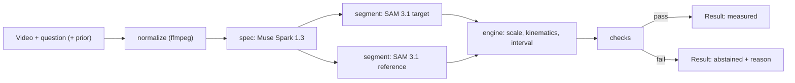

# Architecture

Every number Caliper shows traces back to a mask and a formula, or Caliper abstains. One Muse Spark call, two SAM 3.1 calls, and deterministic Python per question.

## 1. Data flow



## 2. Components

| Module | Job | I/O allowed |
| --- | --- | --- |
| `normalize.py` | ffmpeg to H.264 MP4, `-movflags +faststart`, strip audio, keep original fps, cap width at 1280 px | disk |
| `spec.py` | One Muse Spark 1.3 call: question + video -> `MeasurementSpec` | network, cache |
| `segment.py` | SAM 3.1 requests, stream parsing with `meta-sam-parser`, instance selection, open-weights fallback | network, cache |
| `engine.py` | Scale, positions, local fits, intervals | none (pure) |
| `checks.py` | Checks and abstention reasons | none (pure) |
| `pipeline.py` | Orchestrates the above, writes run JSON | disk |
| `api.py` | FastAPI endpoints | network |
| `config.py` | Every threshold and limit, each with a comment on its origin | none |

Suggested normalize command:

```
ffmpeg -y -i input.mov -an -c:v libx264 -preset veryfast -crf 18 -vf "scale='min(1280,iw)':-2" -movflags +faststart output.mp4
```

Read fps with ffprobe before and after; they must match.

## 3. Data contracts (pydantic v2; mirror these types in web/src/lib/types.ts)

```python
from typing import Literal
from pydantic import BaseModel

Quantity = Literal["size", "speed", "acceleration"]          # MVP
Statistic = Literal["instantaneous", "average", "extent"]

class Prior(BaseModel):
    kind: Literal["size", "speed", "given_depth"]
    object_phrase: str            # what the prior describes, e.g. "lane width"
    value: float
    unit: str                     # SI after conversion: m, m/s

class MeasurementSpec(BaseModel):
    target_phrase: str            # SAM concept prompt, short noun phrase
    target_alt_phrases: list[str] = []
    reference_phrase: str | None  # None when the prior is a speed of the target itself
    reference_kind: Literal["size", "speed", "given_prior", "known_object"]
    reference_value_si: float | None
    reference_source: str         # "question prior", or "world knowledge: INR 10 coin is 27 mm"
    quantity: Quantity
    statistic: Statistic
    axis: Literal["path", "horizontal", "vertical", "longest"] = "path"
    timestamp_s: float | None
    output_unit: str              # unit the question asks for
    depth_info: dict | None       # QuantiPhy 3D field, passed through untouched
    plausible_range_si: tuple[float, float]  # sanity bounds proposed by the model
    notes: str = ""

class TrackFrame(BaseModel):
    frame: int
    t_s: float
    box: tuple[int, int, int, int]
    confidence: float | None
    area_px: int
    centroid_px: tuple[float, float]

class Track(BaseModel):
    phrase: str
    object_ordinal: int
    frames: list[TrackFrame]
    fps: float
    width: int
    height: int

class Check(BaseModel):
    name: str
    passed: bool
    value: float | None
    threshold: str
    detail: str

class Result(BaseModel):
    run_id: str
    status: Literal["measured", "abstained"]
    value: float | None
    unit: str
    interval_90: tuple[float, float] | None
    quantity: Quantity
    spec: MeasurementSpec
    scale_m_per_px: float | None
    method: str                   # e.g. "centroid, local quadratic, window 0.30 s"
    checks: list[Check]
    abstain_reason: str | None
    artifacts: dict               # overlay frames, fit series, URLs
    cost_usd: float
    timings_ms: dict
```

## 4. Spec step (Muse Spark 1.3)

- Upload the normalized video once with the Files API (`purpose="user_data"`), cache the `file_id` by video hash.
- One Responses API call with the video and the question. Ask for JSON that matches `MeasurementSpec`.
- Use the API's structured output mode if the docs confirm the parameter for Muse Spark. Otherwise put the JSON schema in the prompt, validate with pydantic, and retry once with the validation error appended.
- The model may name a known-size object only when the question gives no prior. It must state the size and its source in `reference_source`. Allowed known objects live in `config.KNOWN_OBJECTS` (for example: INR 10 coin 27 mm, cricket ball 72 mm diameter, A4 sheet 297 x 210 mm, printed ArUco card side as measured).
- The model never returns the answer. If it tries, the value is ignored.

## 5. Segment step (SAM 3.1)

1. Concept request for `target_phrase` with `include_confidence: "true"`.
2. Concept request for `reference_phrase` (skip when the prior describes the target).
3. Parse each streamed line with `meta-sam-parser`. Keep per frame: ordinal, box, confidence, mask raster (or RLE in the cache).
4. Instance selection when several objects match: keep the ordinal present in the most frames; break ties by mean confidence, then by mask area. Record the rule used in `Result.method`.
5. Fallback A (ambiguous target): build a box prompt for frame 0 with `build_object_prompt` from the chosen instance and re-run so SAM tracks one object.
6. Fallback B (API down or 5xx after 2 retries): open weights `facebook/sam3.1` on Modal, same output schema.
7. Cache key: `sha256(video) + phrase + model + metadata`.

Limits to respect: 16 objects per frame, 15,000 frames per request, MP4/MOV with H.264/H.265.

## 6. Engine (pure math)

Scale
- Size reference: `s = reference_value_si / reference_extent_px`, where the extent is the median over frames of the mask's longest dimension (or the axis the spec names). Median, not mean, to resist bad frames.
- Speed reference: `s = v_ref_si / v_ref_px`, where `v_ref_px` comes from the reference track's local fit.
- Given depth (QuantiPhy 3D): inspect the `depth_info` field on Phase 3 Day 1 and implement the pinhole relation the data supports (metres per pixel scales linearly with depth). Do not guess its format before looking.

Position
- Primary: mask centroid per frame.
- Secondary: leading edge along the direction of motion (principal axis of the centroid track). Used for the agreement check.

Kinematics
- Time `t = frame / fps`.
- Instantaneous speed and acceleration at `timestamp_s`: least-squares quadratic `p(t) = a + b (t - t0) + c (t - t0)^2` on x and y over a window (start at max(9 frames, 0.30 s); tune on dev only). Speed `|b| * s`, acceleration `2 * c * s` along the motion direction.
- Average speed: path length of the smoothed track divided by elapsed time.
- Size: target extent in pixels along the spec axis, times `s`.

Uncertainty (90% interval)
- Bootstrap, B = 500: resample frames inside the fit window, jitter reference extent by plus or minus 1 px, erode or dilate masks by 1 px at random. Interval = 5th to 95th percentile. Report the point estimate from the full data, not the bootstrap mean.

## 7. Checks (starting thresholds; tune on the dev split only)

| Check | Passes when | Abstain reason shown to the user |
| --- | --- | --- |
| target_found | target present in at least 80% of frames used | "I can't find the {target} in enough frames." |
| reference_found | reference present in at least 50% of frames, or a usable prior exists | "Nothing in view has a known size. Add a coin or tell me one real size." |
| track_continuity | no gap longer than 3 frames inside the fit window | "The {target} is hidden for part of the motion." |
| mask_stability | area coefficient of variation at most 0.25 (rigid objects) | "The outline of the {target} is unstable." |
| estimates_agree | centroid and leading-edge estimates within 25% | "Two ways of measuring disagree; the number isn't reliable." |
| physical_bounds | value inside `plausible_range_si` and inside hard limits in config | "The measurement is physically implausible." |
| interval_width | 90% interval half-width at most 50% of the value | "The uncertainty is too large to be useful." |

## 8. HTTP API (FastAPI, port 8000)

| Method and path | Body | Returns |
| --- | --- | --- |
| `GET /api/health` | none | `{ok, live_runs_enabled}` |
| `POST /api/measure` | multipart: `video`, `question`, optional `prior` (JSON) | `Result` |
| `POST /api/guess` | same as measure | `{text, parsed_value}` from Muse Spark alone (compare mode) |
| `GET /api/runs/{run_id}` | none | `Result` plus artifact URLs |
| `GET /api/runs` | none | list of cached demo runs |
| `GET /api/results` | none | benchmark summary built from `eval/results.csv` |

When `LIVE_RUNS_ENABLED=false`, `/api/measure` and `/api/guess` serve only cached runs (matched by video hash) and return 403 with a clear message otherwise. Per-run and daily spend caps come from `.env`.

## 9. Overlay data for the UI

- For each frame used, send the target and reference outlines as SVG paths (`decode_mask_to_svg_path`), simplified to at most 200 points, plus the centroid.
- Send the fit series for charts: `[{t_s, pos_m, fit_m}]` and, for speed, `[{t_s, speed_m_s}]`.
- The UI draws outlines on a canvas or SVG layer synced to the video with `requestVideoFrameCallback`.

## 10. Deployment

- Web: Vercel (static or Node runtime). Backend: Modal web endpoint (partner credits) or Render.
- Hosted demo runs in replay mode: `web/public/runs/*.json` plus compressed demo clips from our own field set.
- Live mode is enabled only for the recorded demo session and for judges if the rules require it, with spend caps on.

## 11. Cost model (for the budget check)

- SAM 3.1: 2 requests x frames. A 3-second clip at 30 fps is about 90 frames, so about 180 frames per question, about $0.036.
- Muse Spark: one call per question with video; check token counts on Phase 0 and record them in docs/DECISIONS.md.
- QuantiPhy validation (158 questions) end to end should stay within a few dollars. Measure on Phase 0, do not assume.
