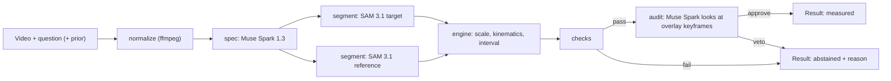
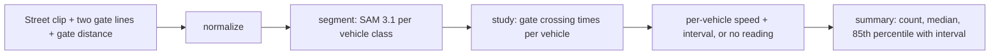

# Architecture

Every number Caliper shows traces back to a mask and a formula, and survives an audit, or Caliper abstains. Per question: at most two Muse Spark calls (spec, audit), one SAM 3.1 call per concept, and deterministic Python.

## 1. Data flow



Street speed study (showcase, same building blocks):



## 2. Components

| Module | Job | I/O allowed |
| --- | --- | --- |
| `normalize.py` | ffmpeg to H.264 MP4, `-movflags +faststart`, strip audio, keep original fps, cap width at 1280 px | disk |
| `backends.py` | One interface for language-model calls: Meta API (`muse-spark-1.3`, video input) or Muse Spark Open on Baseten (keyframes as images) | network |
| `spec.py` | Muse Spark call 1: question + video -> `MeasurementSpec` | network, cache |
| `segment.py` | SAM 3.1 requests, stream parsing with `meta-sam-parser`, instance selection, open-weights fallback | network, cache |
| `engine.py` | Scale, positions, local fits, intervals | none (pure) |
| `checks.py` | Checks and abstention reasons | none (pure) |
| `audit.py` | Muse Spark call 2: overlay keyframes + spec -> `AuditVerdict` (veto only) | network, cache |
| `study.py` | Gate method for many vehicles; per-vehicle intervals; summary statistics (math is pure) | none in the math |
| `pipeline.py` | Orchestrates the above, writes run JSON | disk |
| `api.py` | FastAPI endpoints, live-run caps, replay mode | network |
| `config.py` | Every threshold and limit, each with a comment on its origin | none |

Suggested normalize command:

```
ffmpeg -y -i input.mov -an -c:v libx264 -preset veryfast -crf 18 -vf "scale='min(1280,iw)':-2" -movflags +faststart output.mp4
```

Read fps with ffprobe before and after; they must match.

## 3. Data contracts (pydantic v2; mirror these types in web/src/lib/types.ts)

```python
from typing import Literal
from pydantic import BaseModel

Quantity = Literal["size", "speed", "acceleration"]          # MVP
Statistic = Literal["instantaneous", "average", "extent"]

class Prior(BaseModel):
    kind: Literal["size", "speed", "given_depth"]
    object_phrase: str            # what the prior describes, e.g. "lane width"
    value: float
    unit: str                     # SI after conversion: m, m/s

class MeasurementSpec(BaseModel):
    target_phrase: str            # SAM concept prompt, short noun phrase
    target_alt_phrases: list[str] = []
    reference_phrase: str | None  # None when the prior is a speed of the target itself
    reference_kind: Literal["size", "speed", "given_prior", "known_object"]
    reference_value_si: float | None
    reference_source: str         # "question prior", or "world knowledge: INR 10 coin is 27 mm"
    quantity: Quantity
    statistic: Statistic
    axis: Literal["path", "horizontal", "vertical", "longest"] = "path"
    timestamp_s: float | None
    output_unit: str              # unit the question asks for
    depth_info: dict | None       # QuantiPhy 3D field, passed through untouched
    plausible_range_si: tuple[float, float]  # sanity bounds proposed by the model
    notes: str = ""

class TrackFrame(BaseModel):
    frame: int
    t_s: float
    box: tuple[int, int, int, int]
    confidence: float | None
    area_px: int
    centroid_px: tuple[float, float]

class Track(BaseModel):
    phrase: str
    object_ordinal: int
    frames: list[TrackFrame]
    fps: float
    width: int
    height: int

class Check(BaseModel):
    name: str
    passed: bool
    value: float | None
    threshold: str
    detail: str

class AuditVerdict(BaseModel):
    target_is_right_object: bool
    reference_is_right_object: bool
    reference_same_plane: Literal["yes", "no", "unclear"]
    occlusion_or_identity_switch: bool
    approve: bool                 # false means veto
    reason: str                   # one sentence shown to the user on veto

class Result(BaseModel):
    run_id: str
    status: Literal["measured", "abstained"]
    value: float | None
    unit: str
    interval_90: tuple[float, float] | None
    quantity: Quantity
    spec: MeasurementSpec
    scale_m_per_px: float | None
    method: str                   # e.g. "centroid, local quadratic, window 0.30 s"
    checks: list[Check]
    audit: AuditVerdict | None
    abstain_reason: str | None
    artifacts: dict               # overlay frames, fit series, URLs
    backend: Literal["meta_api", "muse_spark_open"]
    cost_usd: float
    timings_ms: dict

class VehicleReading(BaseModel):
    vehicle_id: str
    vehicle_class: str            # car, motorcycle, auto rickshaw, bus
    status: Literal["measured", "no_reading"]
    speed_kmh: float | None
    interval_90_kmh: tuple[float, float] | None
    t_gate_a_s: float | None
    t_gate_b_s: float | None
    reason: str | None            # why there is no reading

class StudySummary(BaseModel):
    run_id: str
    gate_distance_m: float
    duration_s: float
    vehicles_seen: int
    vehicles_measured: int
    median_kmh: float | None
    p85_kmh: float | None
    p85_interval_90_kmh: tuple[float, float] | None
    speed_limit_kmh: float | None
    share_over_limit: float | None
    readings: list[VehicleReading]
```

## 4. Spec step (Muse Spark call 1)

- Upload the normalized video once with the Files API (`purpose="user_data"`), cache the `file_id` by video hash.
- One Responses API call with the video and the question. Ask for JSON that matches `MeasurementSpec`.
- Use the API's structured output mode if the docs confirm the parameter for Muse Spark. Otherwise put the JSON schema in the prompt, validate with pydantic, and retry once with the validation error appended.
- The model may name a known-size object only when the question gives no prior. It must state the size and its source in `reference_source`. Allowed known objects live in `config.KNOWN_OBJECTS` (for example: INR 10 coin 27 mm, cricket ball 72 mm diameter, A4 sheet 297 x 210 mm).
- The model never returns the answer. If it tries, the value is ignored.

## 5. Segment step (SAM 3.1)

1. Concept request for `target_phrase` with `include_confidence: "true"`.
2. Concept request for `reference_phrase` (skip when the prior describes the target).
3. Parse each streamed line with `meta-sam-parser`. Keep per frame: ordinal, box, confidence, mask raster (or RLE in the cache).
4. Instance selection when several objects match: keep the ordinal present in the most frames; break ties by mean confidence, then by mask area. Record the rule used in `Result.method`.
5. Fallback A (ambiguous target): build a box prompt for frame 0 with `build_object_prompt` from the chosen instance and re-run so SAM tracks one object.
6. Fallback B (API down or 5xx after 2 retries): open weights `facebook/sam3.1` on Modal, same output schema.
7. Cache key: `sha256(video) + phrase + model + metadata`.

Limits to respect: 16 objects per frame, 15,000 frames per request, MP4/MOV with H.264/H.265.

## 6. Engine (pure math)

Scale
- Size reference: `s = reference_value_si / reference_extent_px`, where the extent is the median over frames of the mask's longest dimension (or the axis the spec names). Median, not mean, to resist bad frames.
- Speed reference: `s = v_ref_si / v_ref_px`, where `v_ref_px` comes from the reference track's local fit.
- Given depth (QuantiPhy 3D): inspect the `depth_info` field on Phase 3 Day 1 and implement the pinhole relation the data supports (metres per pixel scales linearly with depth). Do not guess its format before looking.

Position
- Primary: mask centroid per frame.
- Secondary: leading edge along the direction of motion (principal axis of the centroid track). Used for the agreement check.

Kinematics
- Time `t = frame / fps`.
- Instantaneous speed and acceleration at `timestamp_s`: least-squares quadratic `p(t) = a + b (t - t0) + c (t - t0)^2` on x and y over a window (start at max(9 frames, 0.30 s); tune on dev only). Speed `|b| * s`, acceleration `2 * c * s` along the motion direction.
- Average speed: path length of the smoothed track divided by elapsed time.
- Size: target extent in pixels along the spec axis, times `s`.

Uncertainty (90% interval)
- Bootstrap, B = 500: resample frames inside the fit window, jitter reference extent by plus or minus 1 px, erode or dilate masks by 1 px at random. Interval = 5th to 95th percentile. Report the point estimate from the full data, not the bootstrap mean.

## 7. Checks (starting thresholds; tune on the dev split only)

| Check | Passes when | Abstain reason shown to the user |
| --- | --- | --- |
| target_found | target present in at least 80% of frames used | "I can't find the {target} in enough frames." |
| reference_found | reference present in at least 50% of frames, or a usable prior exists | "Nothing in view has a known size. Add a coin or tell me one real size." |
| track_continuity | no gap longer than 3 frames inside the fit window | "The {target} is hidden for part of the motion." |
| mask_stability | area coefficient of variation at most 0.25 (rigid objects) | "The outline of the {target} is unstable." |
| estimates_agree | centroid and leading-edge estimates within 25% | "Two ways of measuring disagree; the number isn't reliable." |
| physical_bounds | value inside `plausible_range_si` and inside hard limits in config | "The measurement is physically implausible." |
| interval_width | 90% interval half-width at most 50% of the value | "The uncertainty is too large to be useful." |

## 8. Audit step (Muse Spark call 2, veto only)

Why it exists: segmentation can track the wrong object, and a coin held closer to the camera than the target silently breaks the scale. Deterministic checks cannot see either; a vision model can. Muse Spark is weak at numbers and strong at judging evidence, so it judges evidence.

- Input: the question, the spec, and 3 to 4 keyframes (start, middle, end of the fit window) with overlays drawn in: target outline (cyan), reference outline (amber), trajectory, frame number. No numbers are shown to the model.
- Output: `AuditVerdict` as JSON. `approve=false` turns the result into an abstention with `reason`.
- The audit never changes a value, an interval, or a threshold.
- Measured in the ablation (`caliper_no_audit` row) and against the human verdicts in `eval/phase0_tracking.csv`: how many wrong-object tracks it catches, how many correct results it wrongly vetoes.

## 9. Street speed study (gate method)

1. The user draws two gate lines across the road on the first frame and types the real distance between them (measured with a tape along the road edge). Optional stretch: SAM 3.1 finds the two markers and proposes the lines.
2. SAM 3.1 concept requests, one per vehicle class present: "car", "motorcycle", "auto rickshaw", "bus". Each returns up to 16 objects per frame.
3. For each track, take the bottom-front point of the mask (where the tyre meets the road, on the side it is moving towards). Find the frame where it crosses gate A and gate B and interpolate linearly between frames for sub-frame crossing times.
4. Speed `v = D / (t_B - t_A)`. Interval: bootstrap over plus or minus 0.5 frame timing jitter at each gate, plus or minus 1 px gate placement, the tape distance tolerance, and the centroid-crossing estimate as a second method.
5. No reading (with reason) when: the vehicle is occluded at either gate, the track identity switches between gates, the two estimates disagree by more than 10%, or the speed is implausible (over 150 km/h).
6. Summary: vehicles seen, measured, no reading; median; 85th percentile with a bootstrap interval over vehicles; share over the speed limit the user enters.
7. The audit (section 8) runs on a sample of up to 5 vehicles per study as a spot check, shown in the report.

Validation: field set A runs through exactly this code path (one car per clip, GPS truth). See EVAL_PROTOCOL H5.

## 10. HTTP API (FastAPI, port 8000)

| Method and path | Body | Returns |
| --- | --- | --- |
| `GET /api/health` | none | `{ok, live_runs_enabled, caps}` |
| `POST /api/measure` | multipart: `video`, `question`, optional `prior` (JSON), optional `backend` | `Result` |
| `POST /api/guess` | same as measure | `{text, parsed_value}` from Muse Spark alone (compare mode) |
| `POST /api/study` | multipart: `video`, `gate_a`, `gate_b` (pixel lines), `gate_distance_m`, optional `speed_limit_kmh` | `StudySummary` |
| `GET /api/runs/{run_id}` | none | `Result` or `StudySummary` plus artifact URLs |
| `GET /api/runs` | none | list of cached demo runs |
| `GET /api/results` | none | benchmark summary built from `eval/results.csv` and `eval/field_results.csv` |

Live-run caps (all from `.env`): max clip length for measure and study, per-IP runs per hour, a cost cap per measure run and per study, and a daily spend cap. Before any API call the backend estimates the run's cost (SAM frames x concepts x $0.0002, plus Muse Spark tokens at the rate measured in Phase 0) and refuses if the estimate is above the run or study cap or the day's remaining budget. When a cap is hit, return 429 with a clear message; the UI offers the cached runs. Cached runs and disk-cache hits never count against caps.

## 11. Overlay data for the UI

- For each frame used, send the target and reference outlines as SVG paths (`decode_mask_to_svg_path`), simplified to at most 200 points, plus the centroid.
- Send the fit series for charts: `[{t_s, pos_m, fit_m}]` and, for speed, `[{t_s, speed_m_s}]`.
- Study: per-vehicle outline at each gate crossing plus its speed label.
- The UI draws outlines on a canvas or SVG layer synced to the video with `requestVideoFrameCallback`.

## 12. Deployment

- Web: Vercel. Backend: Modal web endpoint (partner credits) or Render, with ffmpeg installed.
- Cached example runs from our own clips in `web/public/runs/` work with no backend at all.
- Live runs on for the judging window (Nov 5 to 9) with the caps above, and for recording the demo.

## 13. Cost model (for the budget check)

- SAM 3.1: frames x concepts. A 3-second question clip at 30 fps is about 90 frames x 2 concepts, about $0.036.
- Street study: a 3-minute clip at 30 fps is 5,400 frames per vehicle class; 3 classes is 16,200 frames, about $3.24. Downsample to 15 fps only if timing error stays inside the H5 target.
- Muse Spark: two calls per question (video spec + keyframe audit); measure tokens on Phase 0 and record them in docs/DECISIONS.md.
- Live caps: a 15-second measure clip at 60 fps is 1,800 frames, about $0.36 plus Muse Spark, inside the $0.50 run cap. A 60-second study at 30 fps with 3 classes is 5,400 frames, about $1.08 plus the audit spot-check, inside the $1.50 study cap. Full 3-minute studies run offline with `make study` and are shown as cached runs.
- Keep the Meta Billing spend notification at or below $150.
